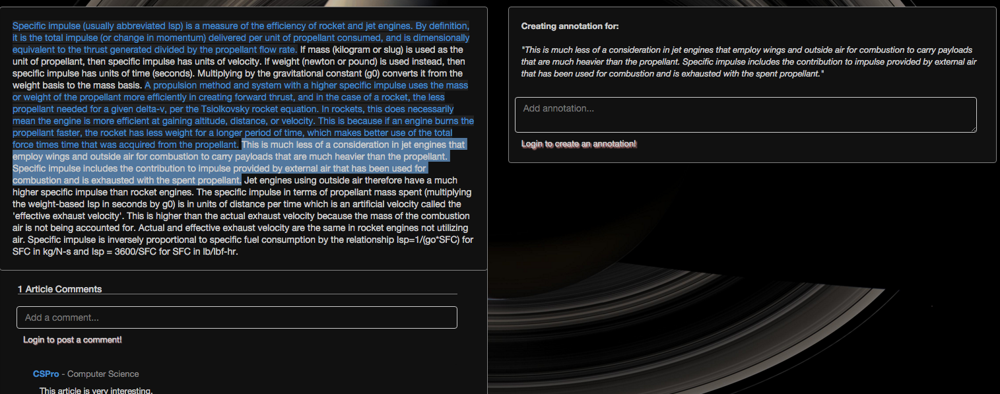
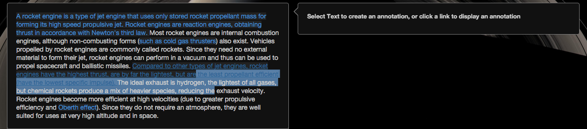
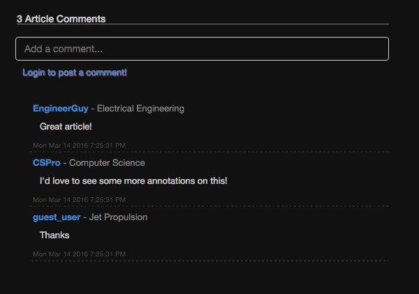
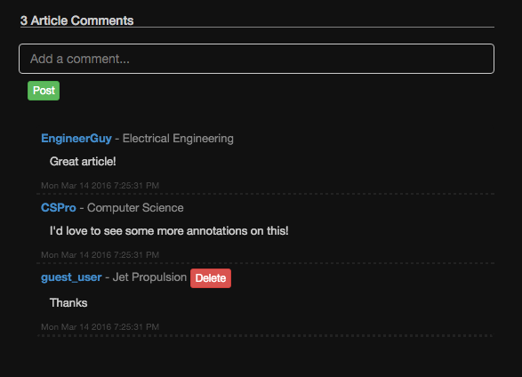

# ELI5ience

- [Website Link][website]

A science focused app for annotating difficult to understand articles. Based on RapGenius.

ELI5ience was built with a Ruby on Rails backend, and a React.js frontend. It is being modernized (Rails 8 backend, rebuilt frontend); see `docs/upgrade-plan.md`.

## Development

The host needs only Docker (with the compose plugin). Do not install Ruby on the host: all Ruby and Rails commands run through `docker compose`.

```sh
docker compose up                             # db:prepare, then Rails on http://localhost:3000 (health check: /up)
docker compose run --rm app bin/rails test    # tests
docker compose run --rm app bin/rubocop       # lint
docker compose run --rm app bin/brakeman      # static security scan
docker compose run --rm app bin/bundler-audit # gem vulnerability audit
docker compose run --rm app bin/rails console # any other Rails command
docker compose down                           # stop (keeps the database and gem volumes; add -v to wipe them)
```

- Stack: Ruby 4.0, Rails 8.1, Postgres 18. Gems live in a named volume, so the first run is slower.
- `config/master.key` is not committed. Development and tests do not need it; production does (`RAILS_MASTER_KEY`).
- The legacy app (for the e2e baseline) runs separately on port 3001; see `docker/legacy/README.md` on the `legacy-baseline` tag.

[website]: http://www.eli5ience.com/

##Main Features
- Annotate articles by selecting text on the article page
  
  - Protections to prevent users from annotating over existing annotations. Screenshot and code demonstrating overlap protection below.
  
  ```javascript
    uniqueSelection: function(text, startIdx) {
      var endIdx = startIdx + text.length;
      var annStartIdx;
      var annEndIdx;
      for (var i = 0; i < this.state.article.annotations.length; i++) {
        annStartIdx = this.state.article.annotations[i].selection_start;
        annEndIdx = annStartIdx + this.state.article.annotations[i].selection_length;
        if (
            (startIdx >= annStartIdx && startIdx <= annEndIdx) ||
            (endIdx >= annStartIdx && endIdx <= annEndIdx) ||
            (startIdx <= annStartIdx && endIdx >= annEndIdx)
          ){
              return false;
          }
      }
      return true;
    },
  ```
- Article pages show all existing annotations as links that open in-page
- Post and delete comments on articles
- Post and delete improvements on annotations
- User view changes based on login status, will show delete/create buttons only when logged in. Code below creates button or login heads-up based on current session:
```javascript
  postBtn: function(session) {
    if (session.length === 0) {
      return <div className='errPost'><a href='./session/new'>Login to post a comment!</a></div>;
    } else {
      return (
        <input className="btn btn-xs btn-success comment-post-btn"
          type="submit"
          value="Post"/>
      );
    }
  },
```
  
  
- Create and delete articles
- Sign Up/Login account management with user profiles


##Additional Features
- Custom authentication in rails
- Session management on backend with frontend reference for tailored UX

- Twitter bootstrap used for styling.


#[Original Design Docs][ogdocs]

[ogdocs]: ./docs/ogdocs.md
